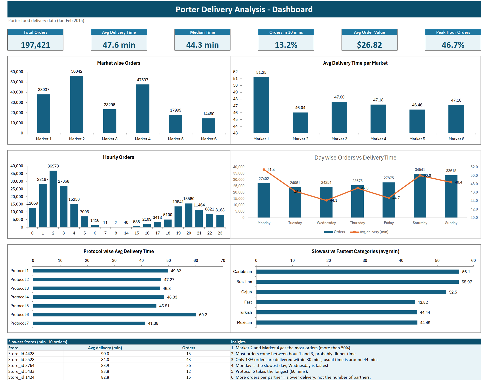

# Porter Delivery Time Analysis (Excel Project)

An Excel data analysis project on food delivery orders for **Porter**, done as part of the **Jobaaj Placement Assistance Program** (case study DACS09).

Customer satisfaction around delivery times was dropping in a few key markets. The goal was to find out what affects delivery time and where Porter can improve.

---

## Dataset

- **Source:** [Porter Delivery Time Estimation – Kaggle](https://www.kaggle.com/datasets/ranitsarkar01/porter-delivery-time-estimation)
- **Size:** 197,421 orders (after removing 7 orders with no delivery time), 14 columns
- **Period:** January – February 2015
- **Main columns:** market_id, created_at, actual_delivery_time, store_id, store_primary_category, order_protocol, total_items, subtotal, num_distinct_items, min/max item price, total_onshift_partners, total_busy_partners, total_outstanding_orders

---

## Tools Used

- Microsoft Excel
  - Power Query (data import)
  - Excel Tables and structured references
  - Formulas: COUNTIFS, AVERAGEIFS, INDEX/MATCH, XLOOKUP, FILTER, CORREL, SLOPE, RSQ, LARGE/SMALL, QUARTILE
  - Pivot Tables and Charts

---

## Data Cleaning

I kept the cleaning light so that no real data was lost.

| Issue | What I did |
|---|---|
| Missing actual_delivery_time (7 orders) | Removed during import (Power Query), as delivery duration can't be calculated without it |
| Duplicate orders | Checked: no exact duplicates found. 134 near-duplicates (same order details, different partner counts, 0.07%) were kept |
| Dates stored as text | created_at and actual_delivery_time converted to date-time |
| Missing market_id (987) | Filled with the most common market (mode) |
| Missing order_protocol (995) | Filled with the mode |
| Missing store_primary_category (4,760) | Filled with "Unknown" |
| Missing partner columns (16,262) | Filled with the rounded average and flagged in a `partners_imputed` column |
| Negative values in partner counts and min price (~100 rows) | Set to 0 |
| Min and max item price swapped (800 rows) | Price range calculated with ABS so it is never negative |
| 35 deliveries over 300 minutes (up to 98 days) | Flagged as data errors in `extreme_delivery` and left out of delivery-time averages only |
| 6,244 statistical outliers (IQR method) | Flagged in `delivery_outlier` but kept, as they are real slow deliveries |
| 74 store categories, many very small | Categories with fewer than 200 orders grouped as "OtherCategories" in a new `category_group` column (original column kept) |

Apart from the 7 orders with no delivery time, **no rows were deleted**. All 197,421 orders are in the cleaned data.

New columns added: delivery duration (min), order hour, day of week, price range, above-average order flag, busy/on-shift ratio, outstanding orders per partner, extreme delivery flag, category group.

---

## Analysis

### Easy Questions
1. Order volume by market
2. Average delivery time by store category
3. Peak hours for orders
4. Busiest days of the week
5. Correlation between number of items and order value
6. Distribution of delivery times and outliers
7. % of orders delivered within 30 minutes
8. Order volume vs busy delivery partners
9. Effect of day of week on delivery time
10. Top 5 stores with the longest delivery times

### Medium Questions
1. Delivery time by order protocol
2. Average order value by market
3. On-shift partners vs delivery time during peak hours
4. Effect of total and distinct items on delivery time (regression)
5. Delivery time trend across the week
6. Item price range vs order value
7. Store category vs chance of an above-average order
8. Variance of delivery times by market and category
9. Busy/on-shift partner ratio vs delivery time by market
10. First-time vs repeat orders (dataset has no customer ID, so a store-level proxy was used)

---

## Key Findings

- **Market 2 and Market 4** handle just over half of all orders.
- Almost **half of all orders (47%)** come in during hours 1–3, which is likely the evening dinner rush.
- Only **13% of orders** are delivered within 30 minutes. The median delivery time is about **44 minutes**.
- **Monday and Saturday** are the slowest days for delivery, **Wednesday** is the fastest.
- **Protocol 6** is the slowest order protocol (about 60 min). Protocol 5 is the fastest of the main ones.
- **Caribbean and Brazilian** are the slowest categories to deliver (about 56 min), while **fast food** is the quickest (about 44 min).
- At peak hours, the **number of orders per partner** affects delivery time much more than the number of partners on shift.
- Orders with more **different dishes** take a little longer, but order size explains only about 2% of delivery time.
- **Burmese, Italian and Steak** orders are most likely to be above the average order value. Convenience-store and fast food orders are the least likely.

---

## Dashboard

The workbook includes a dashboard with:
- KPI cards: total orders, average and median delivery time, % delivered within 30 min, average order value, peak hour share
- Charts: orders by market, delivery time by market, hourly orders, orders and delivery time by day, delivery time by protocol, slowest vs fastest categories
- Table of the slowest stores and a short list of findings

---

## Workbook Structure

| Sheet | Description |
|---|---|
| dataset | Raw data (unchanged) |
| Imputation | Values used to fill missing data and lookup tables |
| Clean | Cleaned data with new calculated columns |
| Summary | Summary tables and pivot tables used by the answers |
| Easy | Answers to the 10 easy questions |
| Medium | Answers to the 10 medium questions |
| Dashboard | Final dashboard |

---

## How to Use

1. Download the Excel file from this repository.
2. Open it in Microsoft Excel (Microsoft 365 or Excel 2021 recommended, as some formulas use FILTER).
3. Start with the **Dashboard** sheet for an overview, then check the **Easy** and **Medium** sheets for detailed answers.

---

## Author

**Manisha Mali**

LinkedIn: [www.linkedin.com/in/manisha-mali-970b44129](https://www.linkedin.com/in/manisha-mali-970b44129)

Feel free to connect with me on LinkedIn for any feedback or questions about this project.
